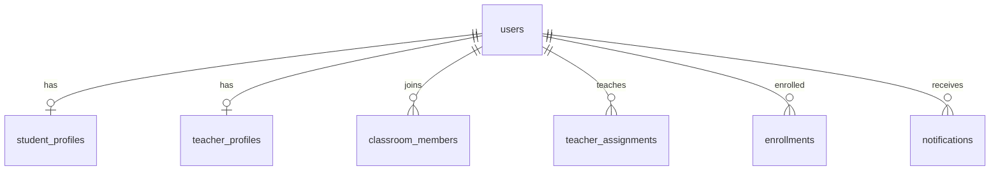
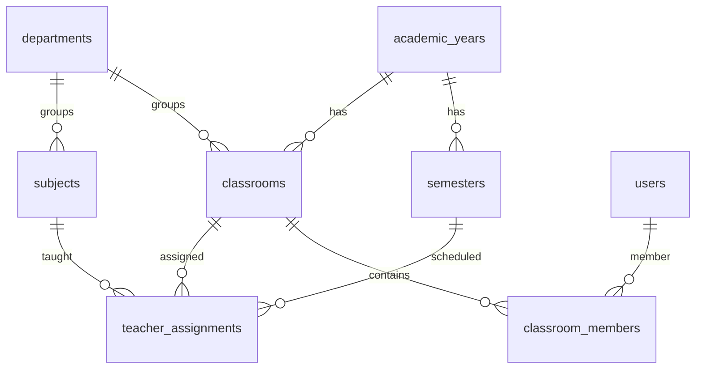
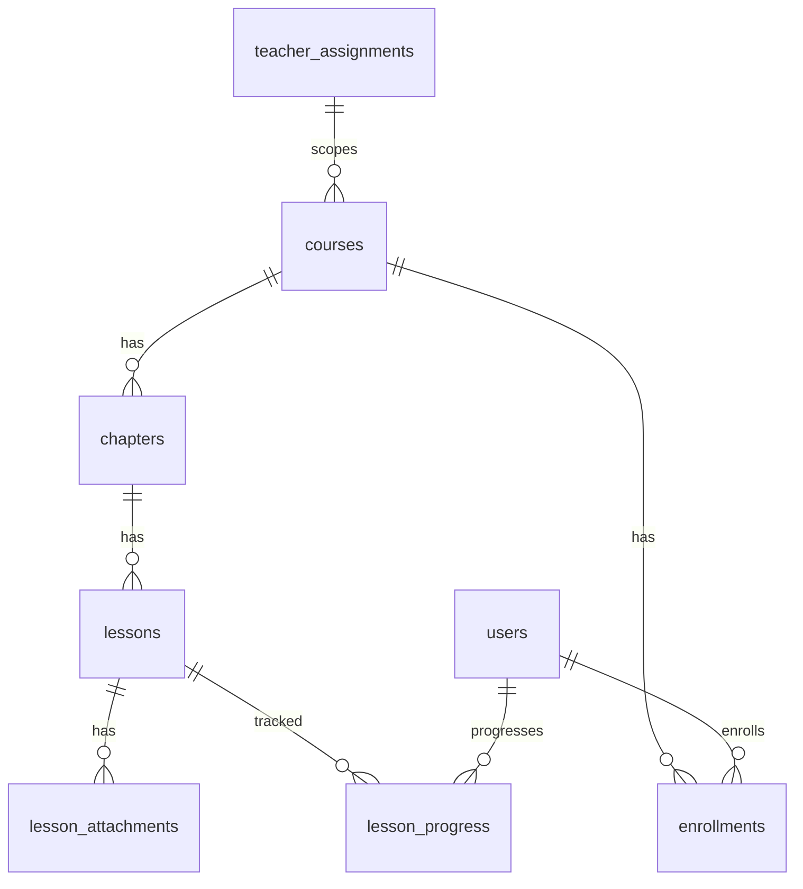
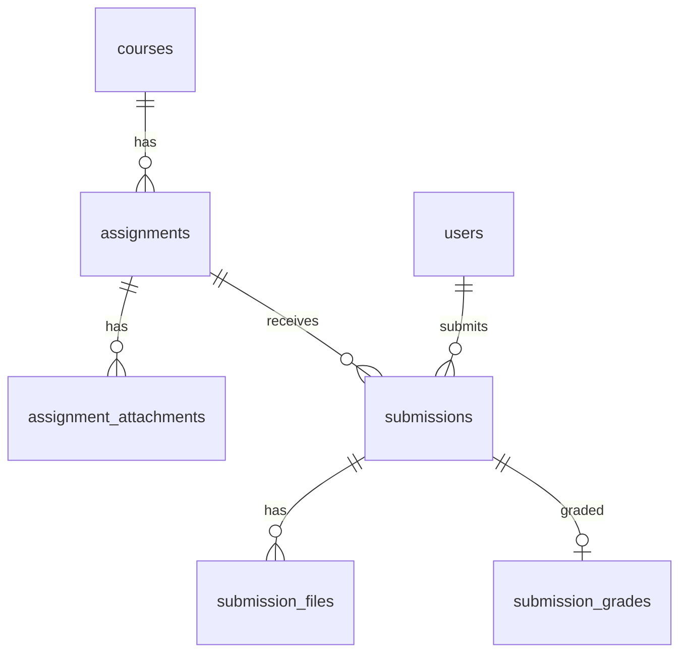
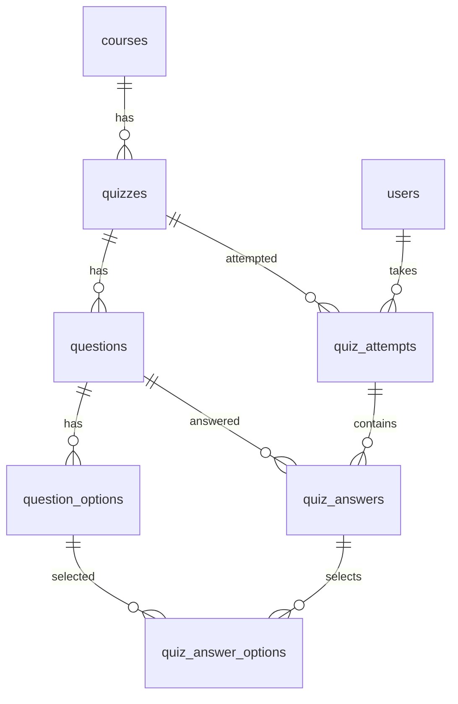
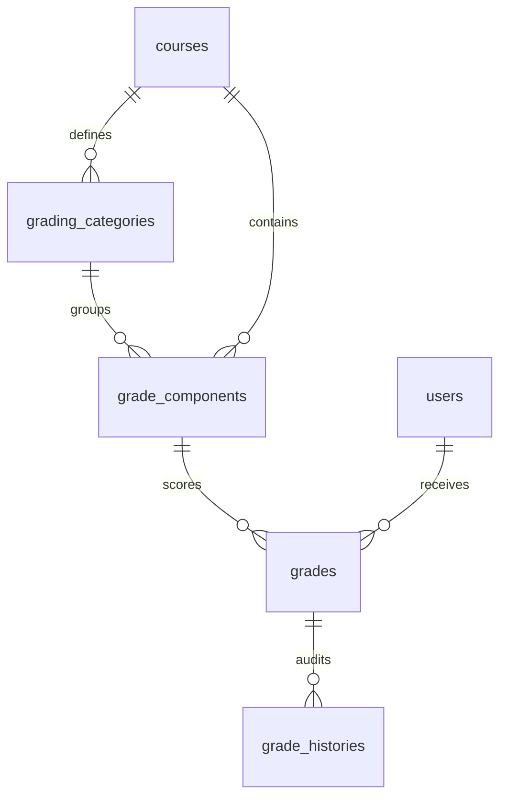
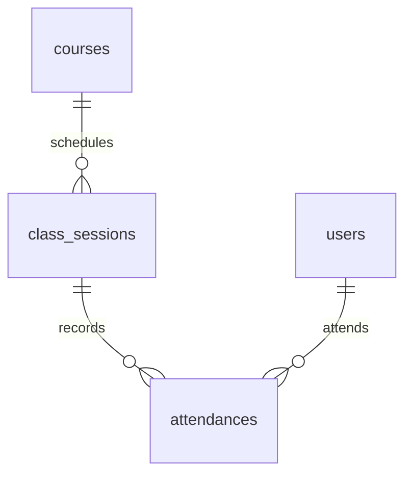
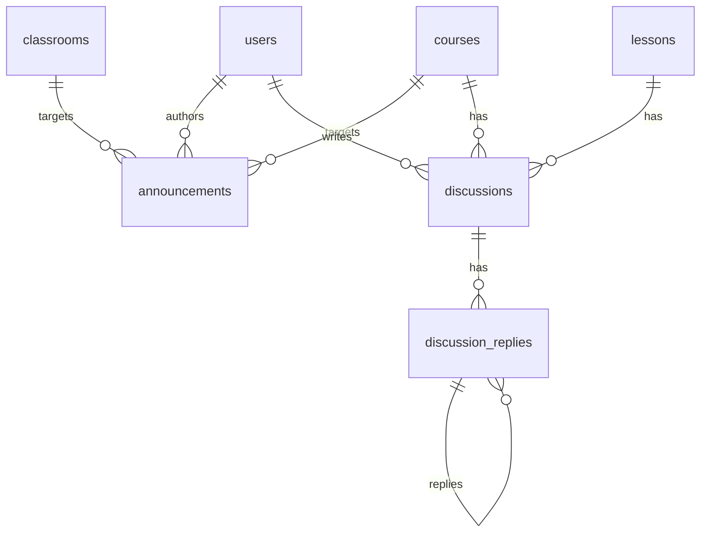

# 02 — Database Schema & ERD

Conventions: InnoDB, `utf8mb4`, `id` bigint PK, `created_at`/`updated_at`,
`softDeletes` only where archival is meaningful, FKs indexed and constrained,
`decimal(5,2)` for scores, `unsignedSmallInteger` for positions.

## 1. Auth & profiles

**users** — name, email (unique), password, phone?, avatar_path?, is_active (default true),
email_verified_at, remember_token, timestamps, softDeletes.
Adds Spatie tables: `roles`, `permissions`, `model_has_roles`, `model_has_permissions`, `role_has_permissions`.

**student_profiles** — user_id (unique, cascade), nisn (unique, nullable), nis (unique, nullable),
gender enum(male,female), birth_place?, birth_date?, address?, guardian_name?, guardian_phone?, timestamps.

**teacher_profiles** — user_id (unique, cascade), nip (unique, nullable), nuptk (nullable),
gender?, phone?, address?, employment_status enum(permanent,contract,honorary)?, joined_at?, timestamps.

## 2. Academic

**academic_years** — name ("2026/2027", unique), start_date, end_date, is_active (single active enforced by service), timestamps.

**semesters** — academic_year_id, name enum(odd,even), sequence, start_date, end_date, is_active,
unique(academic_year_id, name), timestamps.

**departments** — name, code (unique), description?, timestamps, softDeletes.

**classrooms** — academic_year_id, department_id?, homeroom_teacher_id? → users.id,
name ("XI PPLG A"), code (unique per year), grade_level (10|11|12), capacity?, timestamps, softDeletes,
unique(academic_year_id, name).

**subjects** — department_id?, name, code (unique), description?, timestamps, softDeletes.

**classroom_members** — classroom_id, user_id, joined_at, left_at?, status enum(active,transferred,graduated,dropped),
timestamps. Index(user_id, status), index(classroom_id, status).
No unique(classroom,user): one student can re-enter the same class in different years; the
`EnrollmentService` enforces exactly one active membership per academic year.

**teacher_assignments** — teacher_id → users.id, classroom_id, subject_id, academic_year_id, semester_id,
timestamps, softDeletes, unique(teacher_id, classroom_id, subject_id, semester_id).
This row is the teaching scope that owns courses.

## 3. Learning

**courses** — teacher_assignment_id, title, slug (unique), description?, thumbnail_path?,
status enum(draft,published,archived), published_at?, timestamps, softDeletes.
Index(status), index(teacher_assignment_id).

**chapters** — course_id, title, description?, position, is_published (default false), timestamps, softDeletes,
unique(course_id, position).

**lessons** — chapter_id, title, slug, type enum(text,video,pdf,document,link,code),
content_html? (longText), video_url?, external_url?, code_language?, estimated_duration_minutes?,
position, is_published, timestamps, softDeletes, unique(chapter_id, position).

**lesson_attachments** — lesson_id, title, file_path, disk (default private), mime_type, size_bytes,
timestamps. Index(lesson_id).

**enrollments** — course_id, user_id, enrolled_at, completed_at?, status enum(active,completed,dropped),
final_score? decimal(5,2), letter_grade? char(2), timestamps, unique(course_id, user_id), index(user_id, status).

**lesson_progress** — user_id, lesson_id, status enum(not_started,in_progress,completed),
started_at?, completed_at?, last_viewed_at?, timestamps, unique(user_id, lesson_id), index(lesson_id, status).

## 4. Assignment

**assignments** — course_id, title, instructions (longText), due_at, max_score decimal(5,2) default 100,
allow_resubmission bool default false, is_published default false, timestamps, softDeletes,
index(course_id, due_at).

**assignment_attachments** — assignment_id, title, file_path, disk, mime_type, size_bytes, timestamps.

**submissions** — assignment_id, user_id, attempt_no default 1, is_latest default true,
content? (longText), status enum(draft,submitted,late,graded), submitted_at?, timestamps,
unique(assignment_id, user_id, attempt_no), index(assignment_id, status), index(user_id, status).

**submission_files** — submission_id, file_path, original_name, mime_type, size_bytes, timestamps.

**submission_grades** — submission_id (unique), graded_by → users.id, score decimal(5,2),
feedback? (text), graded_at, timestamps.

Revisions = new `submissions` row with `attempt_no + 1`; only one `is_latest` per (assignment, user),
switched inside a transaction. Old rows stay for history when `allow_resubmission` is true.

## 5. Quiz & examination

**quizzes** — course_id, title, description?, type enum(quiz,exam), duration_minutes,
starts_at?, ends_at?, max_attempts default 1, passing_score decimal(5,2) default 70,
shuffle_questions bool, shuffle_options bool, show_result_immediately bool default true,
is_published default false, timestamps, softDeletes, index(course_id, type).

**questions** — quiz_id, type enum(multiple_choice,multiple_select,true_false,short_answer,essay),
question_text (longText), score decimal(5,2) default 1, explanation?, position, timestamps, softDeletes,
unique(quiz_id, position).

**question_options** — question_id, option_text, is_correct bool default false, position, timestamps.
`is_correct` never selected in student-facing queries.

**quiz_attempts** — quiz_id, user_id, attempt_no, started_at, expires_at, submitted_at?,
status enum(in_progress,submitted,graded,expired), score? decimal(6,2), timestamps,
unique(quiz_id, user_id, attempt_no), index(quiz_id, user_id), index(status).

**quiz_answers** — quiz_attempt_id, question_id, question_option_id? (single choice/true-false),
answer_text? (short answer/essay), is_correct? bool, score_awarded? decimal(5,2),
graded_by?, graded_at?, timestamps, unique(quiz_attempt_id, question_id).

**quiz_answer_options** — quiz_answer_id, question_option_id, unique pair. Needed for multiple select
(keeps answers normalized instead of a JSON blob).

## 6. Grading

**grading_categories** — course_id, name enum(assignment,quiz,exam,participation) with label,
weight decimal(5,2), timestamps, unique(course_id, name). Weights must total 100 — validated by
`GradeCalculationService` inside a transaction; a course cannot publish without a valid scheme.

**grade_components** — course_id, grading_category_id, gradeable_type, gradeable_id (morph to
Assignment/Quiz), title, max_score, timestamps, unique(gradeable_type, gradeable_id).
Created when an assignment/quiz is published, so every score points at its source.

**grades** — course_id, user_id, grade_component_id, score decimal(5,2), max_score decimal(5,2),
percentage decimal(5,2), graded_by, is_published default false, timestamps,
unique(grade_component_id, user_id), index(user_id, course_id).

**grade_histories** — grade_id, old_score?, new_score, changed_by, reason? (text),
timestamps, index(grade_id).

## 7. Attendance

**class_sessions** — course_id, meeting_no, topic?, session_date, starts_at?, ends_at?,
qr_token? (unique, nullable), qr_expires_at?, created_by, timestamps, softDeletes,
unique(course_id, meeting_no), index(course_id, session_date).

**attendances** — class_session_id, user_id, status enum(present,excused,sick,absent),
note?, recorded_by, recorded_at, timestamps, unique(class_session_id, user_id), index(user_id, status).

## 8. Communication

**announcements** — user_id (author), title, body (longText), audience enum(all,teachers,students,classroom,course),
classroom_id?, course_id?, is_pinned bool, published_at, timestamps, softDeletes, index(published_at).

**discussions** — course_id, lesson_id?, user_id, title, body, is_pinned, is_locked, timestamps, softDeletes.

**discussion_replies** — discussion_id, parent_id? (self FK), user_id, body, timestamps, softDeletes.

## 9. Gamification (Phase 9, optional)

**badges** — name, slug (unique), description?, icon_path?, criteria_type, criteria_value?, is_active, timestamps.
**user_badges** — user_id, badge_id, awarded_at, unique(user_id, badge_id).
**user_points** — user_id, points (int), reason, source_type?/source_id?, timestamps, index(user_id).

## 10. Framework tables

`notifications` (Laravel), `jobs`, `job_batches`, `failed_jobs`, `cache`, `cache_locks`, `sessions`,
`password_reset_tokens` — keep defaults. Queue is `database`, so jobs tables are required.

## 11. Index / integrity checklist

- Every FK: `foreignId(...)->constrained()->cascadeOnDelete()` or `restrictOnDelete()` for academic masters
  (never cascade-delete a classroom that has grades).
- Unique constraints: `academic_years.name`, `departments.code`, `subjects.code`, `courses.slug`,
  `classrooms(academic_year_id,name)`, `teacher_assignments` 4-tuple, `enrollments(course_id,user_id)`,
  `lesson_progress(user_id,lesson_id)`, `submissions(assignment_id,user_id,attempt_no)`,
  `quiz_attempts(quiz_id,user_id,attempt_no)`, `quiz_answers(attempt_id,question_id)`,
  `grades(grade_component_id,user_id)`, `attendances(class_session_id,user_id)`.
- Composite indexes for the two hot queries: student course list and teacher course list.

## 12. Rollout order (dependency-safe)

1. Auth/profiles + Spatie tables
2. Academic masters (`academic_years` → `semesters` → `departments` → `subjects` → `classrooms` → members → assignments)
3. Learning (`courses` → chapters → lessons → attachments → enrollments → progress)
4. Assessment A (`assignments` → attachments → submissions → files → submission_grades)
5. Assessment B (`quizzes` → questions → options → attempts → answers → answer_options)
6. Grading (`grading_categories` → `grade_components` → `grades` → histories)
7. Attendance
8. Communication (`announcements` → discussions → replies → notifications)
9. Gamification
